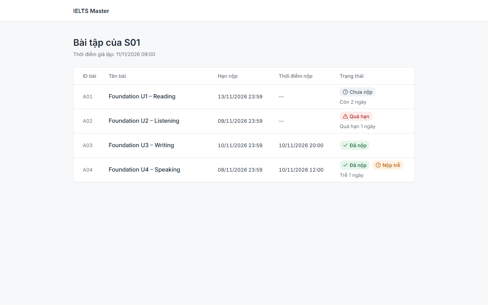

# IELTS Master – My Assignments

[Tiếng Việt](README.md) | **English**

A small app that lists the assignments of the simulated student **S01**, each with a status (Submitted / Not submitted / Overdue / Late).



## 1. Stack
- `client/`: React + TypeScript + Tailwind CSS v4 (Vite), shadcn/ui, Motion.
- `server/`: Node.js + Express + TypeScript. Mock data lives in code (no database).
- Tests: Vitest + supertest (API), 1 Playwright E2E test.

## 2. Structure
```
server/src   data.ts · auth.ts · clock.ts · status.ts (pure logic) · service.ts (filter + attach status) · app.ts · index.ts
server/tests status, clock, API (supertest)
client/src   App.tsx · components/ (AssignmentList, StatusBadge, ...) · lib/ (api, format)
e2e/         1 Playwright test (produces docs/screenshot.png)
design/      final UI design (tokens, components, static previews)
```

## 3. API
`GET /api/assignments` (no parameters):
```json
{ "studentId": "S01", "now": "2026-11-11T09:00:00+07:00",
  "assignments": [{ "id": "A04", "title": "Foundation U4 – Speaking", "dueAt": "2026-11-08T23:59:00+07:00",
                    "submittedAt": "2026-11-10T12:00:00+07:00", "status": "submitted", "late": true }] }
```
`status` is `submitted` | `not_submitted` | `overdue`; `late` is `true` only when submitted after the deadline.

## 4. How to run
```
npm run install:all
npm run dev
```
- Web: http://localhost:5173 (Vite proxies `/api` to the server)
- API: http://localhost:3001/api/assignments

The simulated time is fixed at `2026-11-11T09:00+07:00` (`getNow()` in `server/src/clock.ts`, injectable in tests).

## 5. How to test
```
npm test            # server + client
npm run typecheck
npm run build
npm run e2e         # first time: npx playwright install chromium
```
Last results: server 13 tests pass, client 6 tests pass, typecheck and build OK, E2E 1/1 pass (creates `docs/screenshot.png`).

## 6. Status rules
| Case | Result |
|---|---|
| Submitted | "Submitted" (Đã nộp) |
| Not submitted, now > due | "Overdue" (Quá hạn) |
| Not submitted, now <= due | "Not submitted" (Chưa nộp) |
| Submitted after due (submittedAt > dueAt) | "Submitted" + "Late" (Nộp trễ) |

Result for S01: A01 Not submitted, A02 Overdue, A03 Submitted, A04 Submitted + Late. B01 (belongs to S02) never appears. UI labels are in Vietnamese.

## 7. How S02's data is kept private
- Identity is simulated on the server: middleware calls `getCurrentStudent()` (`server/src/auth.ts`) and sets `req.student`.
- `GET /api/assignments` only uses `req.student` and ignores any studentId in the URL, query, body or headers.
- Filtering by student happens in `service.ts`; the client only renders.
- The response contains only `{id, title, dueAt, submittedAt, status, late}`: no `studentId`, no other student's records.
- Status is computed on the server (`status.ts`, pure function).
- Tests prove it: `?studentId=S02`, body and header attempts return exactly the same result as a plain call, and the JSON never contains "B01"/"S02".

## 8. Not done
- No real authentication (S01 identity is simulated), no authorization.
- No database (data is in code), no deployment, no CI.
- No pagination, search or filters; no submit-assignment feature.
- Fixed time, real clock not used; E2E runs on Chromium only.
- No automatic lint/format (to keep dependencies minimal); types are checked with `npm run typecheck`.

## 9. AI usage
Built with Claude Code (planner, builder, tester and reviewer agents); the logic and tests were reviewed afterwards.
