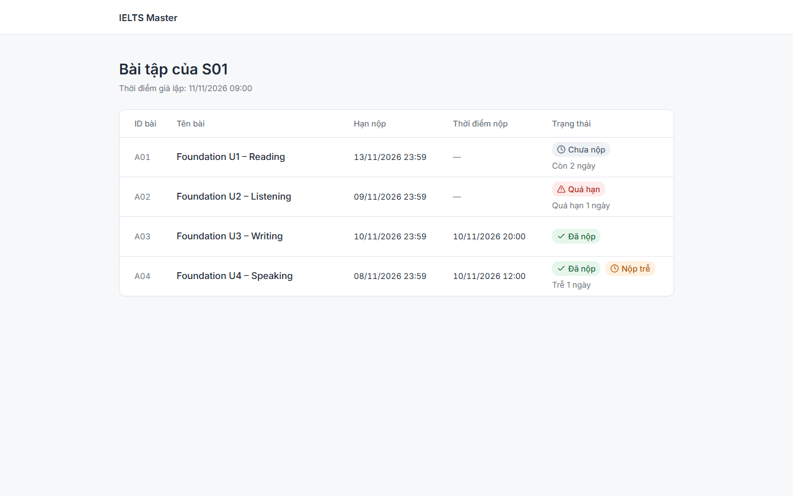

# IELTS Master – Bài tập của tôi

**Tiếng Việt** | [English](README.en.md)

Ứng dụng nhỏ hiển thị danh sách bài tập của học viên giả lập **S01**, kèm trạng thái (Đã nộp / Chưa nộp / Quá hạn / Nộp trễ).



## 1. Stack
- `client/`: React + TypeScript + Tailwind CSS v4 (Vite), shadcn/ui, Motion.
- `server/`: Node.js + Express + TypeScript. Dữ liệu giả lập trong code (không database).
- Test: Vitest + supertest (API), 1 bài E2E Playwright.

## 2. Cấu trúc
```
server/src   data.ts · auth.ts · clock.ts · status.ts (logic thuần) · service.ts (lọc + gắn trạng thái) · app.ts · index.ts
server/tests status, clock, service, API (supertest)
client/src   App.tsx · components/ (AssignmentList, StatusBadge, ...) · lib/ (api, format)
e2e/         1 bài Playwright (tạo docs/screenshot.png)
design/      thiết kế giao diện đã chốt (token, thành phần, bản xem thử)
```

## 3. API
`GET /api/assignments` (không tham số):
```json
{ "studentId": "S01", "now": "2026-11-11T09:00:00+07:00",
  "assignments": [{ "id": "A04", "title": "Foundation U4 – Speaking", "dueAt": "2026-11-08T23:59:00+07:00",
                    "submittedAt": "2026-11-10T12:00:00+07:00", "status": "submitted", "late": true,
                    "daysLeft": null, "daysOverdue": null, "daysLate": 1 }] }
```
- `status`: `submitted` | `not_submitted` | `overdue`; `late` chỉ `true` khi nộp sau hạn.
- `daysLeft` (chỉ khi chưa nộp), `daysOverdue` (chỉ khi quá hạn), `daysLate` (chỉ khi nộp trễ): số ngày tròn 24h, `0` nghĩa là dưới 1 ngày; các trường còn lại là `null`.

## 4. Cách chạy
Yêu cầu Node.js >= 20.19 (Vite cần bản này).

```
npm run install:all
npm run dev
```
- Web: http://localhost:5173 (Vite proxy `/api` sang server)
- API: http://localhost:3001/api/assignments

Thời điểm giả lập cố định: `2026-11-11T09:00+07:00` (hàm `getNow()` ở `server/src/clock.ts`, có thể truyền vào khi test).

## 5. Cách kiểm tra
```
npm test            # server + client
npm run typecheck
npm run build
npm run e2e         # lần đầu: npx playwright install chromium
```
Kết quả đã chạy: server 23 test pass, client 6 test pass, typecheck và build OK, E2E 1/1 pass (1 bài này bao phủ cả trạng thái lỗi, rỗng và có dữ liệu; tạo `docs/screenshot.png`).

## 6. Quy tắc đã cài
| Trường hợp | Kết quả |
|---|---|
| Đã nộp | "Đã nộp" |
| Chưa nộp, now > hạn | "Quá hạn" |
| Chưa nộp, now <= hạn | "Chưa nộp" |
| Nộp sau hạn (submittedAt > dueAt) | "Đã nộp" + "Nộp trễ" |

Kết quả cho S01: A01 Chưa nộp, A02 Quá hạn, A03 Đã nộp, A04 Đã nộp + Nộp trễ. B01 (của S02) không xuất hiện.

## 7. Cách tránh lộ dữ liệu S02
- Danh tính giả lập ở server: middleware gọi `getCurrentStudent()` (`server/src/auth.ts`) và gắn `req.student`.
- Route `GET /api/assignments` chỉ dùng `req.student`, bỏ qua studentId ở URL, query, body và header.
- Lọc theo học viên nằm ở `service.ts`; client chỉ hiển thị.
- Response chỉ gồm `{id, title, dueAt, submittedAt, status, late, daysLeft, daysOverdue, daysLate}`, không có `studentId` hay bản ghi học viên khác.
- Trạng thái được tính ở server (`status.ts`, hàm thuần).
- Test chứng minh: `?studentId=S02`, body và header cho kết quả y hệt gọi thường, và chuỗi JSON không chứa "B01"/"S02".

## 8. Giả định và quyết định
- Trạng thái và số ngày được tính ở server; client chỉ định dạng và hiển thị.
- Số ngày = số khoảng 24h trọn vẹn (làm tròn xuống). Ví dụ A04 trễ 1,5 ngày -> "Trễ 1 ngày"; A01 còn 2,6 ngày -> "Còn 2 ngày"; bằng 0 thì hiển thị "dưới 1 ngày".
- Biên: `now == dueAt` -> Chưa nộp; `submittedAt == dueAt` -> không trễ.
- Thời gian cố định qua `getNow()` có thể truyền vào (inject) khi test.
- Danh tính qua middleware (`req.student`), không đọc từ request.
- Bảng từ 768px trở lên, dưới đó chuyển sang thẻ.
- Thư mục `design/` là đặc tả giao diện (token, hướng dẫn thành phần) dùng để dựng UI.

## 9. Phần chưa làm
- Chưa có đăng nhập/xác thực thật (danh tính S01 là giả lập), không phân quyền.
- Không database, dữ liệu nằm trong code; không deploy; không CI.
- Không phân trang, tìm kiếm, bộ lọc; không có chức năng nộp bài.
- Thời gian cố định, chưa dùng giờ thật; chỉ test E2E trên Chromium.
- Không có lint/format tự động (giữ ít dependency); kiểm tra kiểu bằng `npm run typecheck`.

## 10. Dùng AI
Dự án được làm với sự hỗ trợ của Claude Code (đội agent: planner, builder, tester, reviewer); logic và test đã được rà soát lại.
